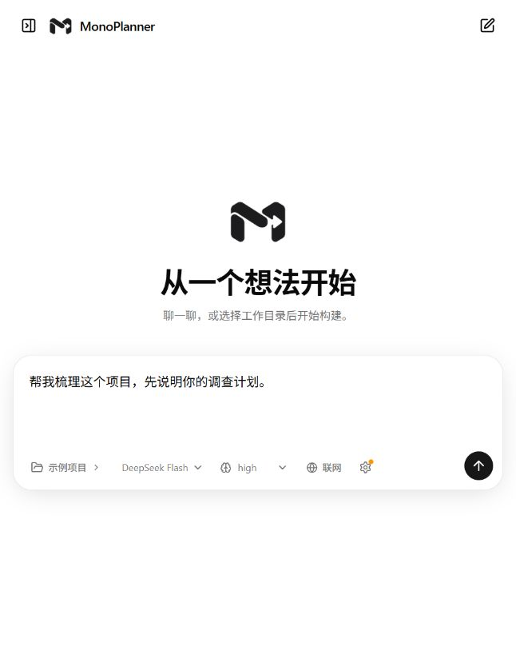

# MonoPlanner

在本机查询资料、运行已有项目任务、实现和验证代码的 AI 助手。你可以直接聊天，也可以选择项目，让它读取源码、运行已有脚本，或按编码流程提出修改并验证。



## 能做什么

- **聊天与工作切换**：同一个输入框，普通聊天不需要工作目录。
- **可见的执行过程**：读取、搜索、运行命令和验收都显示在聊天流中，思考记录可以展开查看。
- **紧凑的聊天界面**：思考和操作按对话轮次分组，默认折叠；展开后可再查看单步内容。输入框随文本增长，左侧对话栏可拖动调整宽度。
- **底部用量统计**：缓存命中率按已返回缓存用量的输入 Token 加权；上下文占用按最近一次主模型请求的输入与回复计算，等待回复时标为估算值。它不是累计 Token，无数据时显示“暂无数据”。
- **运行中补充要求**：继续发消息或暂停任务，在安全边界接入新要求，保留已经完成的操作。
- **可验证的交付**：先试跑并冻结验收，再执行修改；实际失败会反馈返工，文字回复不能替代验收通过。
- **可选联网**：搜索公开资料、读取网页，来源与操作过程保留在本地记录中。
- **资料查询**：查询工作目录和你选定的附加只读资料，普通读取不初始化编码验收。
- **已有任务运行**：运行项目已有脚本或声明的任务，记录真实结果；失败先报告，不擅自修改代码。

## 系统要求

| 组件 | 要求 |
|---|---|
| 操作系统 | Windows，使用当前用户的 DPAPI 保存密钥 |
| 桌面运行时 | Windows 64 位、.NET Framework 4.8、Microsoft Edge WebView2 Runtime |
| Python | 推荐 3.13 |
| Node.js | 22 或更新版本 |
| 包管理器 | pnpm，项目声明版本 10.5.1 |
| 模型服务 | DeepSeek API Key；目前仅支持 DeepSeek Flash |
| Docker | 使用隔离 Shell 调查时需要；普通聊天不需要 |

`MonoPlanner.exe` 是独立桌面窗口，内部复用现有工作界面，仍依赖上述运行环境；目前不是独立安装包。

## 快速开始

在项目根目录打开 PowerShell，安装后端和前端依赖：

```powershell
python -m venv .venv-web
.\.venv-web\Scripts\python.exe -m pip install -r requirements-web.txt
pnpm --dir web install --config.manage-package-manager-versions=false
pnpm --dir web build
```

首次构建桌面入口，运行 `scripts/build-launcher.ps1`；它会下载并核对固定版本的官方 WebView2 SDK，依赖仅放在 `launcher/runtime/`。系统需已安装 [WebView2 Runtime](https://developer.microsoft.com/microsoft-edge/webview2/)。

双击根目录的 **MonoPlanner.exe**，直接进入桌面 App，不打开浏览器，也不会自动发起模型任务。重复打开会显示已有 App 窗口；只有同项目、同版本且资源完整的服务才会复用。保持 EXE、`launcher/runtime/` 和项目文件在一起。

顶部 **MonoPlanner** 菜单提供“刷新界面”“重启服务”和“退出并停止服务”。关闭 App 也会停止服务。有运行中或排队任务时，重启和退出会被阻止：先在工作界面中暂停，并等待当前请求或操作结束。更新后发现旧服务时，仅在任务队列为空时替换旧服务。

需要浏览器访问时，也可以使用 [monoplanner.localhost:3000](http://monoplanner.localhost:3000/)，无需更改系统 hosts 或 DNS。原来的 IP 地址继续有效；App 与浏览器使用各自的界面偏好，但连接同一后端和任务记录。

首次使用，在输入框下方点击 **设置**，填写 DeepSeek API Key 并保存。密钥仅由本地后端读取，界面不会回显已有密钥。

如需分别启动前后端，在两个 PowerShell 窗口中运行：

```powershell
# 后端，默认端口 2024
.\scripts\start-server.ps1

# 前端，默认端口 3000
.\scripts\start-web.ps1
```

## 使用

### 开始一项工作

1. 点击输入框下方的文件夹按钮，打开目录选择窗口。
2. 浏览文件夹，或输入完整路径并点击“打开”，再点击“选择此目录”。
3. 描述目标和限制。助手默认先商讨细节、提出方案，信息充分后询问是否开工。
4. 明确同意开工，或直接说明“你直接动手”“按方案开始实现”，再在聊天流中查看调查、执行和验收结果。

例如：

> 请直接修改登录接口对空用户名的处理，保留现有错误响应格式，并补充回归测试。

“帮我做一个页面”等目标描述默认先讨论；选定目录不代表授权修改。讨论中可以展示完整代码，但不会因此创建文件或执行验收。已经授权的工作无需每一步重复确认；“先不改代码、只讨论、不要保存”等限制优先。

已经开始执行的任务不能中途换目录。需要更换项目时，请新建对话。

中途操作以阶段汇报显示。例如，原始源码试跑发现未通过项时，会提示接下来审查验收与修复方案；配置或加载问题则提示检查验收准备。可展开查看真实诊断，最终通过结论仍由修改后的实际验收决定。

### 模型、思考与联网

模型、思考程度、联网开关和设置位于发送按钮左侧。

| 设置 | 说明 |
|---|---|
| 模型 | DeepSeek Flash |
| 思考 | 关闭、low、high、max；默认 high |
| 联网 | 默认关闭；不影响正常 DeepSeek 模型连接 |
| API Key | 支持填写、替换和删除本机保存的密钥；留空保存保留已有密钥 |

这些选项保存为**新任务默认值**。当前任务及暂停恢复继续使用创建时的配置；设置窗口分别显示当前任务配置和新默认值。

网页搜索会额外调用 DeepSeek，并产生 Token 费用；读取网页不额外调用模型。网页内容只作为外部资料，不执行页面脚本，也不开放调查 Shell 的网络权限。原生搜索接口已完成离线回放，尚未经真实付费调用验证。

### 查询资料和运行已有任务

工作目录用于读取和任务运行。点击输入框下方的 **只读资料**，可添加额外目录；发送下一条消息时登记至本对话。这些目录只供查询，不作为运行或修改目标，运行期间不能变更授权。移除授权后，已经发送过的资料仍在历史中，不能撤回已发送给模型的内容。

可以描述“查看这个项目怎样运行测试”或“按项目说明运行现有测试”。遇到陌生名称，助手先查授权资料，缺少信息或出现多个候选时会询问；没有针对某道评测题的特殊规则。普通聊天不必先搜索。

已有任务支持 Python、JavaScript、PowerShell、Shell 脚本，以及本地 Python 模块和 `package.json` 中声明的任务。运行环境须已安装，助手不会自动安装依赖、启动普通应用，或把临时代码放进运行工具。任务生成的正常缓存和报告仍可能写入磁盘；这不是只读执行沙箱。

聊天流显示运行状态、耗时、退出码及助手已记录的 Token。被运行程序的模型用量与助手自身用量分开：没有可靠记录时显示“未知”。任务可通过 `usage_file` 指定本次生成的 JSON，包含非负整数 `input_tokens`、`output_tokens`、`total_tokens` 和 `cached_input_tokens`；合计必须一致，旧文件不计作本次用量。退出码 0 不等于官方验收通过。

### 补充、暂停与继续

- 运行中可以发送问题或补充要求，界面先确认已收到。
- 当前请求或单项操作结束后处理新消息；已完成的操作保留。
- 普通聊天和状态询问不会取消现有工作，工作补充才调整剩余计划。
- 点击暂停后，在安全边界停下；暂停期间聊天不会自动恢复工作。
- 刷新页面可重新连接会话；暂停后点击“继续任务”恢复。

请求或写入结果不明时，系统保留现场并停止，不自动重发，避免重复计费或重复修改。

### 管理对话

在左侧对话条目上右键，或点击条目右侧的菜单按钮，可归档或删除对话。归档后可在“归档”页查看和恢复；删除会移入“回收站”，仍可恢复，不提供永久清除。操作不会删除工作仓库、任务执行记录或独立评测文件。运行中的任务须先暂停并等待当前请求或操作结束。

对话栏默认较窄，拖动右边缘可调整宽度；也可选中边缘后使用左右方向键，Home 恢复默认宽度。宽度保存在当前浏览器或桌面窗口的界面偏好中。

## 数据与隐私

模型请求会将本轮任务及必要材料发送到 DeepSeek。开启联网后，搜索查询交给搜索服务，网页读取请求发送到对应站点。

本机保存会话、任务记录、代码原文、执行结果及恢复进度。默认位置：

| 数据 | 位置 |
|---|---|
| 任务、设置、加密密钥 | 用户目录下 `.local/state/monoplaner/` |
| 浏览器会话 | 项目目录 `.langgraph_api/` |
| App 界面偏好与缓存 | `%LOCALAPPDATA%/MonoPlanner/WebView2/` |
| 启动日志 | `validation/launcher-logs/` |
| 历史验证与评测 | `validation/` |

可通过 `MONOPLANER_STATE_DIR` 更换任务与设置目录。密钥由 Windows 当前用户加密，不进入浏览器持久存储或模型请求归档。环境变量 `DEEPSEEK_API_KEY` 和项目 `.env` 仍可作为后备；删除本机密钥不会删除这些后备来源。

当前产品面向本机使用，默认仅监听回环地址。任务记录和 `.langgraph_api/` 是恢复所需的数据，请勿在任务进行中删除。

新增查询和运行记录位于任务目录的 `assistant/`。文件读取检查授权路径、链接和敏感文件；子进程不继承服务进程的 API Key 环境变量。**本机执行仍具有当前 Windows 用户的权限，没有实现“工作目录外禁止写入”的系统隔离。** 普通应用启动、独立安装包和系统沙箱尚未提供。

## 常见问题

**双击后没有打开界面。** 查看 `validation/launcher-logs/latest.json` 和相应日志，确认依赖已安装、2024 和 3000 端口没有被其他程序占用。

**更新后仍显示旧界面或目录接口不可用。** 如果更新包含前端源码，先暂停任务并等待当前操作结束，退出 App，运行 `pnpm --dir web build`，再打开 App。仅更新后端时可使用 MonoPlanner 菜单的“重启服务”。刷新界面不会重载后端代码，也不会重新构建前端。

**普通聊天必须先选目录吗？** 不需要。实际源码工作才需要选择目录。

**为什么暂停后不能自动继续？** 如果请求或执行结果不明，需要先核对现场。旧任务也必须使用对应的冻结版本恢复，不能用新代码静默迁移。

**思考是否实时显示？** 工作界面分段接收思考内容，展开后随生成追加显示。思考和操作默认两层折叠，公开回复及用户消息保持可见。工具参数须完整接收并校验后才执行；流式中断会保留已有记录并停止，不自动重发。思考的模型续接规则保持不变，展示不会新增模型调用。

## 开发与维护

- [开发、CLI、评测与离线验证](docs/development.md)
- [前端开发说明](web/README.md)
- [上游来源与 MIT 许可](web/UPSTREAM.md)

项目保留功能回归测试。当前不提供云部署、独立安装包、附件上传或编辑旧消息后重放的功能。
