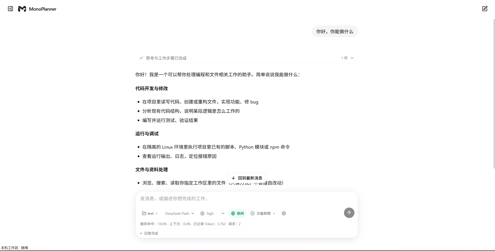

# MonoPlanner 实验版2

> 从当前正式版建立独立工作树，仅替换现有实验版的 RAG 和仓库地图；验收、工作调度和192K／256K压缩保持正式版。源代码不包含运行时、用户数据或历史现场。

> 当前正式开发版已采用统一 RAG 检索；本地模型配置及验证限制见 [RAG 说明](docs/rag-experiment.md)。已发布便携包不会自动更新。

MonoPlanner 是面向 Windows 本机使用的 AI 助手，可讨论需求、查询授权资料、运行项目已有任务，并在 Docker 中修改和验证代码。目前支持 DeepSeek Flash。



## 功能

- 同一界面提供独立 Chatbot 与工作执行。Chatbot 可读取授权资料、联网和解释进度，明确工作要求交给编码内核。
- 自动读取用户项目的依赖配置，在 Docker 中准备并复用环境；日常使用无需填写镜像或解释器路径。
- 主界面持续展示聊天与工作的思考、读取和运行步骤；展开可查看正文，无需手动刷新。Chatbot 另以简短自然的文字说明新发现和进度。
- 普通聊天不打断工作；明确补充进入工作控制队列。暂停立即取消模型并终止当前任务的受管进程，保留中断现场。
- 支持项目目录、额外只读资料、隔离预览及受权限控制的外部打开。
- 支持局部验证、最终冻结验收和失败返工；文字回复不能替代真实验收。
- 保存去重的源码与请求证据；临时调查副本用完清理。结果不明时停止，不自动重复请求或操作。
- 显示 Token、加权缓存命中率和当前上下文占用；缺失用量标为未知。

## 系统要求

| 项目 | 要求 |
|---|---|
| 系统 | Windows 11 x64，普通用户权限 |
| 桌面组件 | .NET Framework 4.8；优先使用系统 WebView2，包内提供备用运行时 |
| 模型 | DeepSeek API Key 及网络连接，调用按服务商规则计费 |
| 编码与已有任务 | 已安装并运行 Docker Desktop，使用 Linux 容器；自动准备需 Docker Engine 28 及以上 |
| 首次环境准备 | 可连接 Docker Hub 及项目依赖的公开下载站点；需要下载空间与时间 |

聊天、查询和预览无需 Docker。便携包包含 Python、Node.js、Git 和生产前端，日常使用无需安装这些工具或 pnpm。它不包含用户项目依赖、正式评测镜像或数据库。

## 下载与启动

本页说明对应 `main` 分支源码。下载包的实际功能以对应 Release 说明为准；源码更新不会自动替换已发布的 ZIP。

1. 在 [Releases](https://github.com/plasticmemories-0823/MonoPlanner/releases) 下载 `MonoPlanner-1.0.0-Windows11-x64.zip` 和 `SHA256SUMS.txt`。私有仓库需要访问权限。
2. 使用 PowerShell 的 `Get-FileHash`，选择 SHA256 核对下载文件。
3. 解压到新的目录，双击 **MonoPlanner.exe**。保持包内文件完整，不与旧版本覆盖混合。
4. 在输入框工具栏选择 **齿轮 → API Key 设置**，填写密钥。

启动不会调用模型或安装依赖。桌面窗口内置本机界面；浏览器也可打开 `http://127.0.0.1:3000/`。界面只连接启动器指定的本机服务，不支持远程服务地址。

关闭桌面窗口会停止接收新操作，取消本实例的模型请求、工作和环境准备，并结束前端、后端及所属子进程。启动或重连尚未完成时也可以退出；服务控制无响应时会限时结束所属进程，不再提供只关闭窗口、后台继续运行的选项。已收到的内容和执行现场保留；未确认的操作需要核对，重新打开不会自动重发。普通浏览器标签页不拥有服务，关闭标签页只关闭页面；日常使用桌面 EXE。旧任务需要对应冻结源码恢复。

若 Docker 引擎本身无响应，本机窗口和服务仍会退出，但容器是否停止只能标为待核对，不能当作已确认停止。

## API Key 与模型设置

密钥由后端使用 Windows 当前用户的 DPAPI 加密保存，界面仅显示是否已配置。留空保存保留已有密钥，也可以替换或删除。`DEEPSEEK_API_KEY` 环境变量与项目 `.env` 是后备来源；删除界面密钥不会删除后备来源。

思考支持关闭、low、high、max，默认 high。主模型单次输出上限为 256,000 Token，包含思考；自动进度沿用用户所选模型配置，标题与上下文压缩使用各自的独立规则。DeepSeek API 跟随 Windows 当前生效的系统网络设置：启用系统代理时按代理及绕过规则连接，关闭后直连，也支持按地址解析 PAC。新设置作用于随后发出的请求，不重发已发出或结果未知的请求；代理连接失败会报错，不偷偷切换路线重试。联网默认关闭，不影响模型连接。模型、思考及联网设置在下个新任务生效，已有任务及恢复继续使用自己的配置。

工作内核使用 DeepSeek 官方 API 时，估算输入达到 192,000 Token 后异步准备摘要；达到 256,000 Token 时先等待并核验摘要，再发送下一次工作请求。最近原文和工具调用配对始终保留，摘要不改写原始记录。压缩请求单独记录用量，暂停会取消后台压缩，结果未知不会自动重发。Chatbot 和其他模型仍沿用原有 80% 压缩策略及输出预留检查；主输出上限保持 256,000 Token。水位是程序估算的实验选择，不代表已证实的模型质量分界。

网页搜索和读取分别直接调用 DeepSeek Search／Fetch API，使用已配置的 DeepSeek 密钥。Search 返回标题、链接、摘要等结构化结果；Fetch 返回 Markdown，不再额外调用聊天模型，也不在本机下载或解析目标网页。查询原文及 URL 发送给 DeepSeek，API 连接跟随系统网络设置；联网开关继续控制工具执行。按官方人民币价格，非空成功请求每次 ¥0.005，空结果及失败不收费；结果未知时保留费用预留并停止，不自动重发。费用与模型 Token 分开记录。本机界面与后端通信始终直连。

环境下载在代理模式下，通过同一代理向 Cloudflare 的加密 DNS 查询目标域名，避免本机 DNS 异常导致下载被错误拦截；只发送域名及记录类型，不发送网页路径、模型密钥或聊天内容。解析结果仍须通过公网检查，失败不会跳过检查或改走直连。

## 基本使用

### 聊天与编码

普通聊天无需工作目录。编码时启动 Docker Desktop，选择工作区：可以是已有项目，也可以是存放新项目的父目录。描述目标、限制和完成条件后，助手会提出简要方案及实际项目位置，询问是否按照这个计划开工；回答“开始”后才创建或绑定项目并执行。已经明确要求“按方案开始实现”或“请直接修改”时，不重复询问。选择目录本身不代表批准编码，“只讨论、不要保存”等限制优先。

> 帮我制作一个鹈鹕骑自行车的动画网页。

新项目默认在所选工作区下建立有名称的子文件夹，确认时会说明位置。明确要求“直接放在当前根目录”时可使用根目录；目录不必为空，也不必是 Git 仓库。修改已有项目时沿用该项目，重名的新目录不会被覆盖。其他独立 Git 子项目不参与本次源码、安装或执行；若项目明确依赖它们，程序会说明范围冲突，需要重新确认目标。不会自动初始化 Git，也不会因上层存在仓库就扩大选定范围。

回复达到输出上限时，程序保存收到的内容和用量并停止，不执行该回复中的工具。可以先询问停止原因，或点击“继续任务”。继续前会核验原记录、源码、验收和容器，已完成操作不会重跑；只有本程序正常停止且身份未变化的原容器可以重新启动。继续属于新的模型请求，仍会产生费用，也不保证没有重复思考。

调查阶段可在只读副本中运行局部检查；源码修改须先提交完整验收，试跑并明确冻结后执行。Chatbot 与工作使用独立上下文，普通问答不进入工作请求；明确补充才交给工作内核。工作思考与操作从本地记录持续增量显示，结束后停止读取；断线只补读，不重发任务。工作到达关键阶段后，Chatbot 根据本地事实简短说明“我刚查到什么、完成了什么”；有记录依据时再说明下一步。自然语言汇报之间至少间隔 30 秒，思考和操作显示不受这个间隔限制；没有新事件不会空转调用。每次自动汇报最多调用模型 3 次，只能读取当前工作的事实和受控记录，不能操作任务。聊天、工作、进度与标题分别统计用量，自动汇报也产生模型费用。普通聊天与工作仍沿用所选思考程度和原有输出上限。

点击暂停会立即停止新操作派发，并尝试终止本任务的模型连接和容器进程，不等待写操作执行完。已发生的修改或删除不会自动撤销。界面只有确认终止后才显示已暂停；结果不明时保留容器和证据，核对前不能自动续跑。切换工作目录会暂停旧任务并新开对话。

### Docker 执行环境

默认使用 **自动准备**。选目录只保存允许工作的范围，不触发下载；确认开工位置后，程序针对实际项目检查配置并复用环境，没有可用环境时才下载基础工具和声明的依赖。界面“当前项目”显示实际目录，环境查询、重试和高级配置都针对这个目录，普通聊天和目录浏览不会触发安装。

- 基础环境包含 Python、Node.js、Git 和常用编译工具；空项目使用产品默认版本。
- Python 项目识别版本声明、requirements、pyproject、uv、Poetry 和 Pipfile 锁文件，自动准备支持 Python 3.9 及以上；Node.js 项目识别 package.json、版本声明及 npm、pnpm、Yarn 锁文件。也检查常见前后端子目录。
- 项目环境保存在本机。运行时、依赖及必要安装输入没有变化时直接复用；界面、注释或排版变化不会触发重建。依赖变化时为后续任务准备新环境。项目自己的 Windows 虚拟环境、node_modules 或已安装软件不会被直接复制进 Linux 环境。
- 安装材料按需要收集：无依赖目录不复制项目文件；普通依赖仅提供声明和锁文件；安装项目自身、本地包或执行安装脚本时，才补充相应项目源码。遵守项目忽略规则，明确引用的必要资料仍逐项核验。准备前核算文件数和大小，超限会说明具体路径及纳入原因。
- 普通源码修改可复用依赖环境；非可编辑本地包及安装脚本输入变化需要重新准备。
- 安装发生在一次性容器中的过滤副本，不在 Windows 上安装项目依赖。Node 依赖使用只读 Docker 数据卷；项目及调查副本可能出现空的 node_modules 挂载目录，不写入依赖内容。
- 首次执行绑定镜像 ID、容器和挂载；已有执行记录不更换环境。恢复时不会重新安装或重放操作。准备失败会保留记录；修复网络或项目配置后可重试准备，再继续尚未开始的任务。

已有手动环境仍然保留，位于 **高级设置**。可以切回自动模式，选择只影响后续首次执行。自动准备不调用额外模型，也不使用评测题目的专用镜像。

当前自动准备主要覆盖上述 Python 和 Node.js 项目。项目需要私有凭据、外部数据库服务、特殊系统库、GPU 或 Windows 专有软件时，不能保证自动完成；程序会说明失败，不能跳过依赖或回退本机执行。未在项目中声明的依赖不会靠猜测安装。编码期间新增依赖应通过新的环境准备供后续任务使用，不在冻结验收中途更换运行条件。

自定义 Dockerfile、Conda 配置和没有锁文件的 Pipfile 暂不自动执行，可继续使用已有的高级环境配置。自动准备会隐藏本机 node_modules 并提供容器依赖，不适用于直接修改版本库中托管的 node_modules 源码。

准备阶段允许通过受控代理连接公网下载站点；正式编码、调查、验收和已有任务容器仍无网络。需要任意联网或宿主机 Docker 控制的脚本不属于当前支持范围。依赖下载与聊天工具栏的“联网搜索”开关相互独立。

构建授权、构建中的镜像下载和项目依赖下载通过准备期间的受控转发服务，跟随当前系统代理及 PAC 规则，无需填写 Clash 等软件的地址或端口。仅打开代理软件但未启用系统代理，不等于启用了系统代理；TUN 等系统网络路由由操作系统处理。首次取得构建工具镜像仍由 Docker Desktop 下载，遵循 Docker 自己已有的代理设置；若 Docker 使用手动代理，Windows 开关不能覆盖它。程序会在失败时说明这一环节，不修改用户的全局 Docker 设置，也不自动重复下载。

打开环境设置或点击重新连接时，只核对镜像、依赖和已有准备状态，不重新安装。已经停止或不存在的准备容器会更新状态；Docker 无响应或资源归属不一致时仍保留待核对提示。下载失败后需明确点击重新准备，不能通过刷新自动重试。

### 资料、文件与权限

**齿轮 → 额外可读资料** 可添加文件或目录。单文件只授权自身；添加资料不授予修改、执行或启动权限。移除授权无法撤回已发送的资料。

| 权限 | 行为 |
|---|---|
| 沙盒权限 | 默认；编码及已有任务在 Docker 中，禁止本机外部启动和目录外写入 |
| 风险询问 | 编码仍在 Docker 中；外部打开与明确的单文件操作需逐次批准 |
| 完全权限 | 本机文件操作与外部启动使用当前 Windows 用户权限，无逐次确认，不申请管理员权限 |

权限仅作用于当前对话，在执行边界生效，刷新和恢复保留；新对话默认沙盒。模型不能切换权限或批准自己。批准绑定操作、软件、目标及原件状态，重复点击不重复执行。

文本、代码、Markdown、HTML、常见图片和 PDF 可在隔离预览中查看，不自动发送给模型。外部打开不接受任意 Shell 或启动正文；软件自身写入不受编码容器约束。

### 对话管理

首条消息保存后后台生成一次短标题，产生少量额外模型费用；失败保留临时标题。列表右键菜单可归档或删除；删除移入回收站，彻底删除需确认并清理关联记录及独占闲置环境。其他任务仍需使用的共享环境会保留。工作仓库和独立评测文件不随对话删除。旧版记录可只读查看，旧未完成任务须使用冻结旧版恢复，不迁移执行检查点。

在齿轮菜单的空间与环境入口查看记录和资源占用。默认闲置缓存软预算为 20GiB，目标盘预留 5GiB；程序只回收自身拥有且无引用的缓存，不执行 Docker 全局清理。暂停和结果未知的任务仍占用必要空间；空间不足会停止新准备，不删除恢复证据。

源码或环境准备失败会立即显示原因，保留原现场；刷新、重新连接和普通问答不会重新复制或安装。需要重试环境时，展开“当前项目”再明确点击准备。新目录创建结果不明时不会重复创建或覆盖。目录范围检查有数量及时间边界，所选范围过大时会要求缩小位置；不会把整个资料盘静默复制到任务记录。

如果本地运行记录也无法写入，程序停止派发新工作和模型请求，并显示存储故障。暂停仍尝试终止本任务；记录或终止无法确认时显示待核对，不宣称暂停成功。释放磁盘空间不会自动重跑任务，需先核对现场。

## 数据与隐私

用户消息、读取的源码和资料、工具结果、必要历史及思考续接字段会发送给 DeepSeek；标题请求只使用首条公开用户消息。联网搜索发送查询，网页读取将 URL 发给 DeepSeek，由其联系对应站点。产品不是完全离线工具。

环境准备会向容器和软件包仓库请求所需版本；不向安装容器传递模型密钥或本机凭据。项目安装脚本和第三方软件包可能执行代码，只应打开可信项目。准备时使用过滤后的临时资料副本；材料清单和安装日志保存在本机环境记录中，不自动发送给模型。

| 便携版数据 | 默认位置 |
|---|---|
| 任务、设置、加密密钥、源码快照和执行记录 | `%LOCALAPPDATA%/MonoPlanner/Data/state/` |
| 会话、命令和公开事件 | 上述目录的 `application.sqlite3`；旧框架数据仅保留为历史 |
| 启动日志和加密实例凭证 | `%LOCALAPPDATA%/MonoPlanner/Data/` |
| 桌面缓存与界面偏好 | `%LOCALAPPDATA%/MonoPlanner/WebView2/` |
| 环境作业、所有者和资源索引 | 状态目录下的 `resources.sqlite3`；准备材料与安装日志位于 `managed-environments/` |

下载的环境镜像和依赖卷由 Docker 管理。清空 Docker 会删除它们：新任务可以重新准备，已绑定但丢失容器的旧任务不能自动重建。

本地完整记录可能包含源码、业务数据和个人路径，应妥善保护，运行时不要删除恢复记录。`MONOPLANER_STATE_DIR` 可指定任务与设置目录；从源码启动默认使用用户的 `.local/state/monoplaner`。

界面与会话服务仅监听回环地址，通过实例凭证、同源代理和浏览器会话保护，不要将它们暴露到公网或局域网。环境准备期间会另开临时下载转发端口供 Docker 访问；该端口要求本次准备的随机口令，只能访问公网下载目标，准备结束即关闭。这些措施不防御已经控制当前 Windows 用户或 Docker 的恶意程序，也不构成百分之百安全保证。详见 [安全说明](docs/security.md)。

## 故障处理

| 问题 | 处理 |
|---|---|
| 页面无法连接 | 查看启动日志，使用“重新连接”只重试读取，不重发模型请求或修改 |
| 端口被占用 | 处理自己确认的占用程序，或从源码用独立端口启动；不关闭无关程序 |
| 未配置模型密钥 | 在设置中填写，检查当前用户及后备环境变量 |
| Docker 尚未就绪 | 启动 Docker Desktop，等待引擎就绪后重试准备 |
| 环境准备失败 | 检查网络及项目依赖文件，查看本地安装日志；确认原因后点击重试，不会重放编码任务 |
| 旧环境或容器已删除 | 新任务可重新准备；已绑定旧容器的任务须保留现场，不能自动替换 |
| 请求或操作结果不明 | 保留现场，核对本地记录，不盲目重复运行 |
| 旧任务无法恢复 | 使用对应冻结版本，不迁移检查点绕过源码核验 |

发布包未使用代码签名，是否允许运行应遵循自己的组织策略，不建议关闭系统防护。干净 Windows 环境的兼容性以发布说明中的实际验证范围为准。

## 开发

源码开发需要 Python 3.13、Node.js 和 pnpm 11.25.0：

```powershell
python -m venv .venv-web
.\.venv-web\Scripts\python.exe -m pip install -r requirements-dev.txt
pnpm --dir web install --frozen-lockfile
pnpm --dir web test
pnpm --dir web lint
pnpm --dir web build
.\.venv-web\Scripts\python.exe -m pytest tests -q
.\scripts\build-helpers.ps1
.\scripts\build-launcher.ps1
.\scripts\start-app.ps1 -NoBrowser
```

首次准备桌面 SDK 和便携运行时需要网络；发布包启动不下载或构建依赖。目录、CLI、内部工具协议、通用评测和打包方法见 [开发文档](https://github.com/plasticmemories-0823/MonoPlanner/blob/main/docs/development.md)。回归测试、假模型服务及实验分析不由生产入口加载，也不进入发布包。

## 许可证

自有代码采用 [MIT](LICENSE)。界面保留 Agent Chat UI 的 MIT 许可；Python、Node.js、Git、WebView2、LangGraph 开源库等组件遵循各自许可，包括 GPLv2 和 Microsoft 条款。详见 [第三方说明](docs/third-party.md) 和包内 `licenses/`，自有代码的 MIT 不替代第三方许可。
